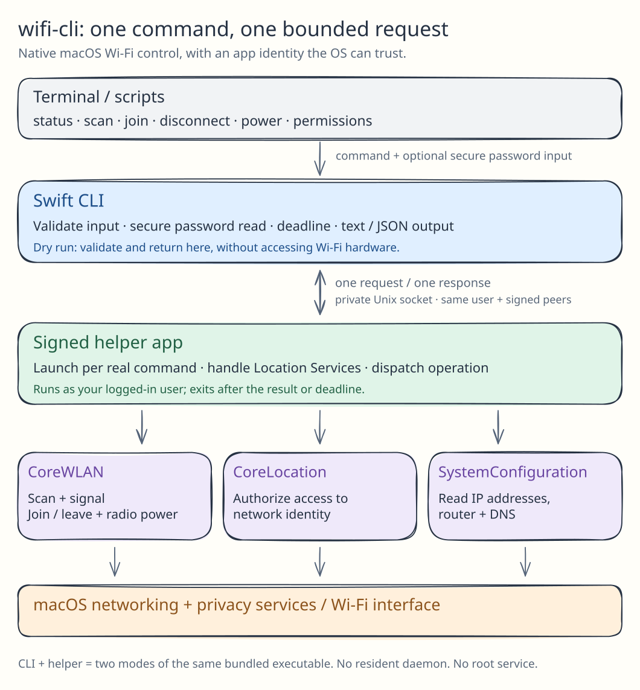

# wifi-cli

Native macOS Wi-Fi control. Swift + Apple frameworks, no package dependencies.
macOS 13+; Swift 5.9+ to build.

```sh
./scripts/build.sh
./dist/bin/wifi status
./dist/bin/wifi scan --json
./dist/bin/wifi join 'My Wi-Fi'  # hidden password prompt
```

Also supports `disconnect`, `power on|off`, and `permissions`.
Use `--dry-run` to validate changes; `./dist/bin/wifi --help` for options.

Missing network names? Run `./dist/bin/wifi permissions --request`.
Run without `sudo`; keep `dist/bin/wifi` and `dist/WiFiHelper.app` together.

## Architecture



CLI validates input → signed helper handles permissions → Apple APIs control Wi-Fi.
One helper per command; no daemon.

[CLI guide](docs/guide.md) · [Skill & MCP setup](docs/agents.md) · [Editable diagram](docs/architecture.excalidraw)
